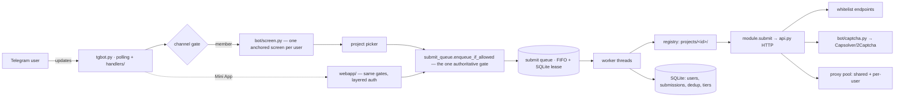

<div align="center">

# 🤖 AutoRegi

**Self-hosted Telegram bot that files your own accounts into NFT whitelist forms.**

Consent-based submissions · one Python module per project · queue, tiers, proxies, Mini App


</div>

---

AutoRegi registers `handle|wallet` pairs — **uploaded by their owner via `/data`** —
into allowlist / whitelist forms of NFT projects. Each target site is a small,
self-contained module; the bot core handles the queue, per-user limits, proxies,
captcha solving and the Telegram UX, including a Mini App.

> ### 🛡️ Non-negotiable design rules
> - **Consent only** — the bot submits accounts the user explicitly uploaded, nothing else.
> - **No private keys, ever** — sites that require a wallet signature are out of scope.
> - **No captcha bypasses** — challenges are solved only via paid services
>   (Capsolver / 2Captcha / Anti-Captcha), every solve is paid for.
> - **Submission integrity** — never file an attestation the endpoint could verify
>   as false (empty tokens, dead links). A site can accept a row and silently drop
>   it from the final list — acceptance is not inclusion.

## ✨ Features

| | |
|---|---|
| 🧩 **One module per project** | `projects/<id>/` = `project.toml` + `module.py` + optional `api.py`. Copy `_template/` to start. |
| 🚪 **Channel gate** | The bot only serves members of a channel you configure. |
| 🎟️ **Tiered limits** | Free / subscriber (file + group) / paid plan / VIP. Only `OK` submissions burn a slot. |
| 🔁 **Global wallet dedup** | A wallet already `OK`/`ALREADY` for a project is never submitted again — by anyone. |
| 📥 **Crash-safe queue** | Global FIFO with a SQLite lease protocol: a crash costs one lease timeout, then the job resumes. Live progress message per job. |
| 🌐 **Proxies** | Shared pool (`proxy.txt` + extra files, URL-deduped) and per-user uploads with all-or-nothing validation. |
| 🧠 **Captcha solving** | Turnstile / reCAPTCHA via Capsolver, 2Captcha, Anti-Captcha — the operator's balance or the user's own key. |
| 💎 **Payments (optional)** | NOWPayments USDT BEP-20; `PAYMENTS_ENABLED=0` removes the shop entirely. |
| 📱 **Mini App** | Projects, queue, mint calendar and settings on the same gates — layered auth, rate limits. |
| 🗓️ **Mint calendar** | Quote-gated X fact extraction with T-1h opt-in reminders. Off by default. |
| 🌍 **RU/EN i18n** | Every user-facing string, per user. |
| 🛠️ **Admin panel** | Stats, user cards, project health & runtime disable, paced broadcasts, `/reload`. |

## 🚀 Quick Start

**Requirements:** Python 3.11+, a bot token from [@BotFather](https://t.me/BotFather);
optionally a channel you administer (for the gate), proxies, solver keys, a NOWPayments key.

```bash
git clone https://github.com/Anda4ka/AutoRegi.git && cd AutoRegi

python3 -m venv venv && . venv/bin/activate
pip install -r requirements.txt

cp .env.example .env && chmod 600 .env
$EDITOR .env        # BOT_TOKEN at minimum; ADMIN_IDS for /admin

python tgbot.py
```

Production (systemd — see `ops/README.md`):

```bash
sudo cp ops/tgbot.service /etc/systemd/system/
sudo systemctl enable --now tgbot
```

<details>
<summary><b>⚠️ Two operational rules that save hours</b></summary>

1. **Run exactly one poller per `BOT_TOKEN`.** Two processes polling the same
   token get `409 Conflict` from Telegram — the bot just looks dead.
2. **Persistent state lives outside the checkout** (`~/.autoreg`, override with
   `AUTOREG_STATE_DIR`): user profiles, proxies, queue payloads, SQLite, logs.
   Never point it back into the repo or a `git clean` wipes your users' data.
   Backup: `ops/backup_state.sh`; migrate hosts: `ops/migrate_state.py`.

The authoritative env-var list with defaults is `bot/config.py`;
`.env.example` annotates the ones you'll actually touch.

</details>

## 🧩 Adding a project

```
projects/<id>/
  project.toml   # id, name, enabled, order, ok_limit, links, health probe
  module.py      # parse / validate / submit adapter
  api.py         # (optional) HTTP for the site
```

```bash
# 1 — recon the site's API and scaffold a draft folder
python tools/scaffold_project.py https://example.com --id myproj --init

# 2 — finish the adapter by hand (contract & API cookbook: PROJECTS.md)

# 3 — smoke-test on your OWN accounts, verify rows on the site's side
python tools/smoke_project.py myproj --user <your_telegram_id> --count 10 --dry-run
python tools/smoke_project.py myproj --user <your_telegram_id> --count 10

# 4 — enabled = true in project.toml, then restart (or admin /reload)
```

Full contract, `project.toml` reference, API cookbook (Supabase, Firestore,
GAS sheets, Next.js actions, Netlify Forms, Google Forms) and the definition
of done: **[PROJECTS.md](PROJECTS.md)** · hard-won bug stories: **[docs/PITFALLS.md](docs/PITFALLS.md)**

## 🏗️ Architecture



Key invariants (details in **[AGENTS.md](AGENTS.md)**):

- **Every path to a submission goes through the same gate** — chat buttons,
  batch upload and the Mini App all call `enqueue_if_allowed`: tier limits,
  slot reservation, duplicate jobs, runtime-disable and global wallet dedup
  are checked exactly once, in one place.
- **The queue lives in the bot process's memory** backed by SQLite — the
  `submit_jobs` table is a record, not a work list.
- **Closed forms self-disable**: an explicit `closed` verdict (or `404/410`)
  on a project's probe runtime-disables it and soft-cancels its jobs.

## 📂 Layout

| Path | Role |
|------|------|
| `tgbot.py` | wiring + submit orchestration; handlers in `handlers/` |
| `bot/` | core: config, SQLite (`bot/db/`), registry, limits, queue, proxies, i18n, captcha, billing, broadcast, alerts |
| `projects/` | one folder per project; `_template/` is the starter, `example/` a live demo |
| `webapp/` | Telegram Mini App (thread inside the bot process) |
| `tools/` | scaffolding + live smoke tests |
| `ops/` | systemd units, backup/migration, runbook |
| `tests/` | pytest suite |

```bash
pip install -r requirements-dev.txt && pytest -q tests/   # 554 tests
```

## ⚖️ Legal / Acceptable Use

This tool automates form submissions **for accounts their owner explicitly
uploaded**. Rate limits, global deduplication and per-user caps are built in.
Respect the target sites' terms of service and your local law; the authors
take no responsibility for abuse. If a site says no automation — don't point
AutoRegi at it.

## 📄 License

[MIT](LICENSE) — do what you want, carry the attribution, don't blame us.

<div align="center">
<sub>Built for people who register their own wallets, at their own pace.</sub>
</div>
